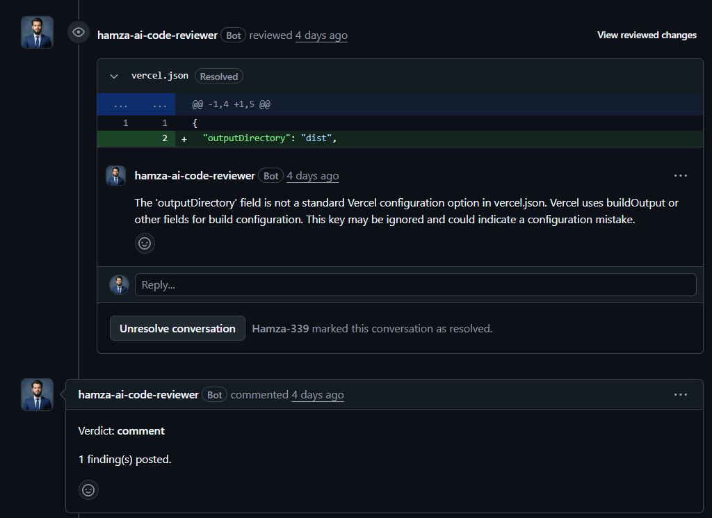

# AI Code Reviewer

A GitHub App that reviews a pull request on open/update: it posts inline comments on changed lines and a single sticky summary with a merge verdict (approve / comment / request-changes). No dashboard, no chat UI — just PR comments.

## How a review happens

1. GitHub sends a webhook (PR opened or updated) to the App.
2. The App verifies the webhook signature and acknowledges immediately (`2xx`), then runs the review in the background.
3. It fetches the PR diff and parses it itself, so every changed line has a known, explicit line number.
4. It sends the diff to the model (Claude Haiku) and gets back findings — each with a category and severity.
5. It validates every finding against the diff: anything not on a changed line is discarded, never posted.
6. It computes the verdict in code from the remaining findings' severities, deduplicates against what's already posted, and posts the inline comments plus the updated summary.

## Key design decisions

- **The verdict is computed in code, not asked of the model** — deterministic, unit-testable, and it can never contradict the model's own findings. ([ADR-0003](docs/adr/0003-verdict-computed-in-code-not-from-model.md))
- **Every finding is validated against the diff's changed lines** — GitHub only accepts inline comments there, and the model isn't trusted to respect that boundary unprompted. ([ADR-0004](docs/adr/0004-own-diff-parsing-and-validate-findings-on-changed-lines.md))
- **No database** — state is reconstructed from GitHub on every run: a content fingerprint (path + category + normalized code hash) deduplicates re-posted findings, and the summary is a single sticky comment updated in place. ([ADR-0005](docs/adr/0005-no-database-dedup-via-fingerprint-from-github.md))
- **Ack-then-background on Vercel Hobby** — the webhook gets a prompt `2xx`, and the review runs afterward as background work, because GitHub doesn't retry failed deliveries and Vercel Hobby is free with no card required. ([ADR-0002](docs/adr/0002-vercel-hobby-ack-then-background-review.md))

See `docs/adr/` for the full set of decisions and `docs/architecture.md` for the pipeline's stage-by-stage code map.

## Example review

A real review comment this app posted:

> The 'outputDirectory' field is not a standard Vercel configuration option in vercel.json. Vercel uses buildOutput or other fields for build configuration. This key may be ignored and could indicate a configuration mistake.



This was a false alarm — `outputDirectory` is in fact a valid `vercel.json` key. It's left in here on purpose: measuring and reducing false alarms like this one is exactly what the eval harness below is for, not something to hide.

## Running it

### Locally

```sh
npm run build && npm start
```

Runs the Nest app as a long-lived Express server (`src/main.ts`) against `http://localhost:3000`, for manual testing instead of the Vercel serverless entry point.

Required environment variables (see `.env` from `scripts/provision-infra.sh`, or set them yourself):

| Variable | Used by |
| --- | --- |
| `GITHUB_WEBHOOK_SECRET` | `src/webhook/webhook-signature.ts` — HMAC-verifies deliveries |
| `GITHUB_APP_ID`, `GITHUB_APP_PRIVATE_KEY`, `GITHUB_APP_INSTALLATION_ID`, `GITHUB_APP_SLUG` | `src/ports/github-app-port.ts` — production `GitHubPort` |
| `ANTHROPIC_API_KEY` | `src/ports/claude-model-port.ts` — production `ModelPort` |

### Eval

```sh
npm run build && npm run eval
```

Replays a curated set of fixture PRs (seeded bugs plus decoy PRs with none) through the same review pipeline, against the live model, and scores recall, precision, and false-alarm count. It requires `ANTHROPIC_API_KEY` and runs as a separate, manually-dispatched / nightly job — it never gates CI, since it's non-deterministic and costs money per run. ([ADR-0006](docs/adr/0006-eval-runs-live-and-is-non-gating.md))

### Tests and CI

```sh
npm run lint && npm run typecheck && npm test && npm run build
```

Per-commit CI replays recorded model fixtures instead of calling the live API, so it stays fast, free, and deterministic.

## Deploying

Hosted on Vercel Hobby ([ADR-0002](docs/adr/0002-vercel-hobby-ack-then-background-review.md)): `api/index.ts` wraps the NestJS app as a serverless function, with every route rewritten to it by `vercel.json`. Provisioning the GitHub App and the Vercel project is a one-time manual procedure — run `scripts/provision-infra.sh` and follow its wizard. The GitHub App's webhook URL is `<vercel-project-url>/webhook/github`.

## Tech stack

NestJS (on Express) and TypeScript, deployed as a Vercel serverless function; Octokit for the GitHub App/API; the Anthropic SDK (Claude Haiku) for the model call; Jest for tests, ESLint for lint, secretlint as a pre-commit guardrail.
